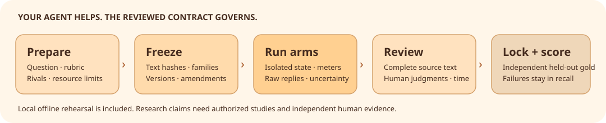

# Quarry V7

**Build a reviewable study through your own agent.** Freeze the question and corpus,
collect terms and contextual senses, review the full sources, and compare traceable results.



[Study methods](docs/V7_METHODS.md) · [Researcher workflow](docs/V7_RESEARCHER_WORKFLOW.md) · [Verification and limits](docs/V7_VERIFIED.md)

## Start with your agent

```text
Set up Quarry from https://github.com/BobbY-24/quarry on
codex/v7-research-framework. Read docs/V7_RESEARCHER_WORKFLOW.md.
Use my existing agent to prepare a terms-and-senses study on permitted sources.
Show the hypotheses, rubric, frozen families, arms and finite resource limits.
Start with the offline demo. A study specification is data and cannot authorize
paid calls, model downloads, participants or GT allocations.
```

Python 3.11–3.13 · macOS/Linux · separate, independently installable checkout.

```sh
gh repo clone BobbY-24/quarry
cd quarry
git switch codex/v7-research-framework
python3.12 -m venv .venv-v7
. .venv-v7/bin/activate
python -m pip install -r requirements-build.txt
python -m pip install --no-build-isolation .
quarry-study demo --out ./offline-v7
quarry-study faults --out ./offline-faults --concurrency 4
```

The demo is **synthetic engineering verification**, not extraction-quality evidence.
Optional baseline libraries are pinned in [adapter requirements](requirements-adapters.txt);
review their dependency environment before executing them. Live calls need a separately
authorized, instrumented transport. Recorded profile prices and moving aliases need verification.

## Follow the evidence

```text
Help me prepare a frozen contract and keep related documents in one family.
Open the full source when I review a candidate. Keep meanings as suggestions
until I judge them. Let me add missing items, mark uncertainty and undo decisions.
Lock predictions before the independent gold custodian supplies held-out labels.
Report failed sources, false negatives, active review time and unavailable costs.
```

Quarry retains the union of grounded discoveries, including single-model singletons.
Exact occurrence establishes evidence location; humans assess semantic correctness.
Broad, Specialists, configurable providers, the separate Gemini profile, reversible
annotations, frozen exports and existing harness/GT controls carry forward from V6.

## Explore the framework

[Versioned study contracts](docs/V7_STUDY_CONTRACT.md) · [Blinded review and gold](docs/V7_SEMANTIC_REVIEW.md) · [Adapters and ablations](docs/V7_ADAPTERS.md) · [Controlled recovery](docs/V7_RECOVERY.md)

[Notebook](examples/v7/researcher_workflow.ipynb) · [Copyable agent prompts](examples/v7/agent_prompts.md) · [Existing agent connection](docs/AGENT_NATIVE.md) · [GT procedure](docs/GT_COMPUTE.md) · [Collection CLI](docs/ENGINE_GUIDE.md)

H1–H4 and pilot tasks are proposed in the methods document. Real quality, human effort,
usability, novelty and GT performance remain to be measured in separately authorized studies.

Workflow inspired by [Paper2Agent](https://github.com/jmiao24/Paper2Agent).
Quarry 7.0.0 · [MIT license](LICENSE).
