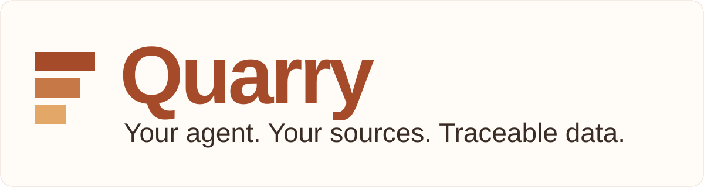
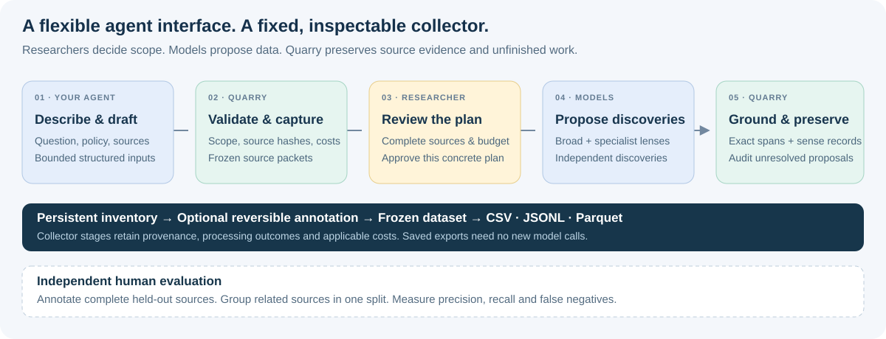
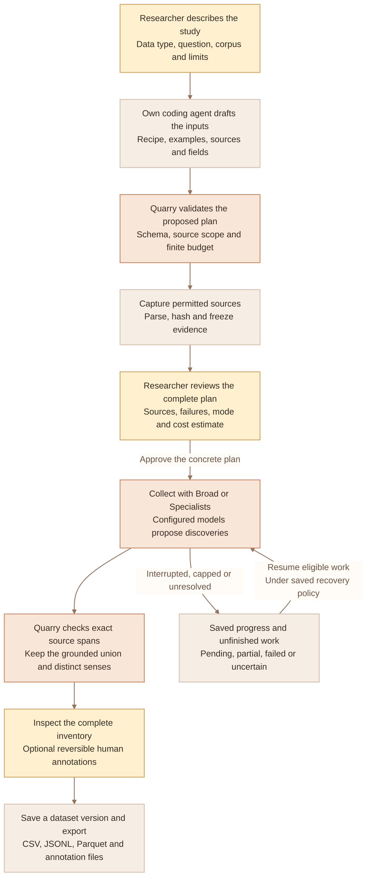
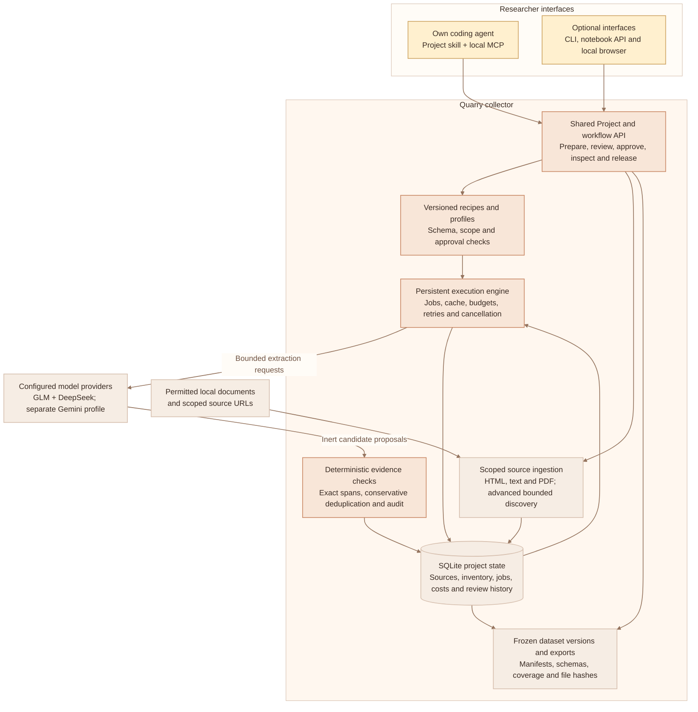
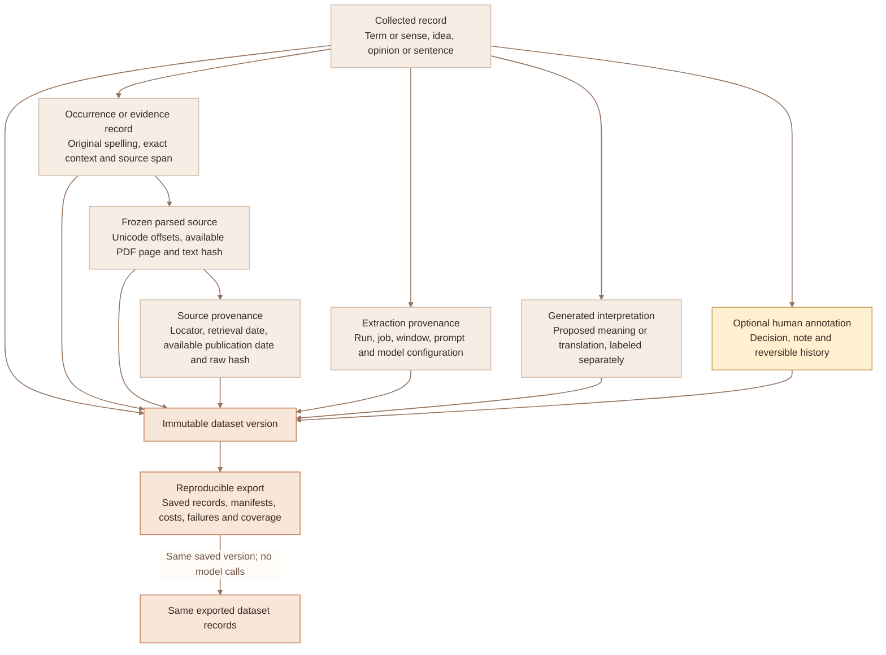
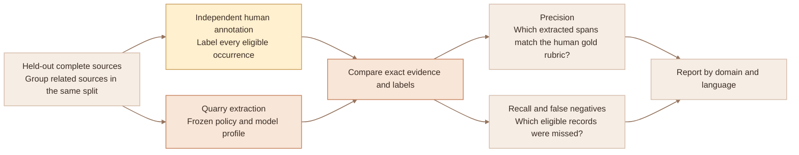

# Quarry — research collection through your own agent

**Describe your study. Review the plan. Collect, inspect, resume and export in the same conversation.**

Quarry turns a research question into a source-traceable dataset through your existing
Claude Code, Codex or other local MCP harness. Your agent prepares the inputs;
Quarry runs the fixed collection pipeline. **Terms and senses are the primary output.**
Exact source spans expressing ideas, opinions and sentences are also supported.
Quarry is the product name for the V6 collector.

**Quarry · engine V6.6.0** · Python 3.11–3.13 · [MIT](LICENSE) · [Offline verification](docs/CLUSTER_VERIFIED.md)

[Quick start](#quick-start) · [Choose compute](docs/COMPUTE.md) · [GT workflow](docs/GT_COMPUTE.md) · [Research examples](#research-examples) · [How it works](#how-it-works) · [Diagrams](#quarry-diagrams) · [Install](#installation-on-macos-or-linux) · [Documentation](#documentation)

## Quick start

### 1. Ask your coding agent to set up Quarry

Paste this into the local research workspace where you want to use Quarry:

```text
Install Quarry from https://github.com/BobbY-24/quarry.
The Quarry package is at the repository root on the default branch.

Read the README and src/termfinder/agent_skill/SKILL.md.
Use a fresh Python 3.11–3.13 environment with the pinned dependencies.
Preserve existing files, studies and my agent settings.

Use termfinder connect for my current harness and this research workspace.
Keep the default offline gate. Follow the host's activation steps, then
verify an actual list_studies tool call. Tell me any remaining trust/reload step.

Review the bundled examples/offline_demo.py, then run it in a fresh output
directory using the finite OS isolation procedure in docs/VERIFICATION.md.
Use it as a zero-dollar synthetic rehearsal. Handle structured inputs for me.
Do not make paid collector calls or expose credentials.
```

The repository is private; your GitHub account needs access. Use a coding agent
with local terminal/file tools and project skill or stdio MCP support. Ordinary
ChatGPT/Claude web chat can use the [file-handoff fallback](docs/AGENT_WORKFLOW.md).

The setup writes a project-local skill and MCP configuration. Follow your host's
normal trust/reload steps; **a successful Quarry tool call verifies the connection**.
[Connection and troubleshooting](docs/AGENT_NATIVE.md) cover Claude Code, Codex
and generic harnesses.

### 2. Choose your extraction compute

Your planning agent and Quarry's extractors use separately configured resources.
Quarry does not bundle a developer key or charge a shared account. Each study
uses your chosen API, local model server or authorized institutional endpoint.

```text
Create a study for me, then help me choose its extraction compute:
my own API account, my installed local model, or my authorized institutional
compute. Show the endpoint, model/version, pass count, credential variable
name and cost assumptions. Record my chosen backend with configure_compute,
then confirm it with inspect_compute. Do not ask me to paste keys into chat,
launch compute, download models or start collection.
```

For example: “Use my Fireworks account with the GLM + DeepSeek preset,” or
“Use my reviewed local Ollama model at `http://127.0.0.1:11434/v1`.” Supply the
exact custom model/checkpoint revision. Credential values stay in the approved
environment of the process running Quarry. [Compute setup](docs/COMPUTE.md)
covers personal APIs, local Ollama/vLLM and Georgia Tech/PACE deployments.
Configuration alone does not enable real inference or allocate cluster access.

**Using Georgia Tech compute?** Keep your existing agent. Configure a reviewed
site profile once, capture sources before GPU allocation, review the finite
resource request, and submit a durable Slurm job. Reconnect to inspect, cancel,
resume and import its source-backed results. Submitted cluster work survives the
chat closing. Use a CPU collector against an approved institutional gateway, or
the fixed vLLM launcher with reviewed pre-staged weights inside the same GPU job.
Quarry does not download models or execute model-supplied code.
[GT setup and student procedure](docs/GT_COMPUTE.md) ·
[Site profile, CLI and notebook examples](examples/gt-compute/README.md).

### 3. Describe your research

After setup, ask for a study in ordinary language:

> Use Quarry to create `ev-language` from my permitted EV discussion exports.
> Collect new expressions and changed senses, exclude names used only as names,
> and retain singleton uses. Use English, Broad, at most 30 sources and a $10 cap.
> Show the complete source list, policy, problems and cost estimate before collection.

Your agent drafts the recipe, examples, source declarations and output fields.
Quarry checks the inputs, captures permitted source evidence and prepares the review.
Before collection, change the policy in conversation without editing engine code.
For a processed study, follow the [incremental/changed-study procedure](docs/AGENT_NATIVE.md)
or create a separate study; unchanged plans retain their resume state.

**The default connection collects only with the synthetic fake provider.**
Real collection requires an explicitly authorized provider connection, configured
credential environment, finite budget and approval of the concrete plan.
Follow [the pilot connection procedure](docs/AGENT_NATIVE.md#real-provider-authorization).
The example's $10 is a cap, not an estimate or authorization. Your own agent's
charges are separate and unknown to Quarry.

### 4. Collect, inspect and continue

Once the concrete plan and real-provider connection are authorized, use requests
like these. The agent handles Quarry's saved identifiers and tools:

| Your request | What Quarry preserves |
| --- | --- |
| “Start the reviewed collection within its approved cap.” | Persistent jobs, source scope, costs and unfinished work |
| “Show the exact passage and page or offsets for this expression.” | Original text, source hash, dates and extraction provenance |
| “Mark this sense as needing review. Undo that annotation.” | Reversible annotation history and the complete inventory |
| “Open `ev-language`, show unfinished work and resume its unchanged plan.” | Saved progress, cache and budget state |
| “Save `pilot-v1` and export CSV, JSONL, Parquet and annotation files.” | Frozen records, schemas and a reproducibility manifest |
| “Run this reviewed study on our GT profile, then show progress after I reconnect.” | Separately reviewed resources, durable scheduler job, finite caps and checkpoint/result import |

No browser or manual JSON handoff is required in the connected workflow.
Ask for the optional local **Plan / Evidence / Dataset** view when visual review helps.

## Research examples

These proposed workflows draw on publications relevant to Georgia Tech's NLPx
research community, including work with Wei Xu and Alan Ritter. They are product
examples, not PI requests, lab adoption claims or dataset reproductions.

| Research direction | Ask your agent | Inspect in the output |
| --- | --- | --- |
| **Evolving vocabulary**, inspired by [NEO-BENCH](https://arxiv.org/html/2402.12261v4) | “Collect new expressions and changed senses from my permitted dated community sources. Exclude entity-only names; retain singletons and separate senses.” | Terms, senses, exact contexts and first observation **in this corpus** |
| **Multilingual cultural vocabulary**, inspired by [Camellia](https://arxiv.org/abs/2510.05291) and [CARE](https://arxiv.org/abs/2504.05154) | “Include cultural expressions and entities, including established names. Keep original scripts and distinguish proposed translations from observed text.” | Language, community, original evidence and separately labeled model suggestions |
| **Technical jargon**, inspired by [MedReadMe](https://arxiv.org/abs/2405.02144) | “Collect established medical terminology from my permitted text-bearing PDFs. Preserve page contexts and source-supported definitions; show parsing failures.” | Jargon evidence, page locations and definition provenance |

Choose **Broad** for independent extraction passes, or **Specialists** to add
recipe-specific lenses. Customize languages, dates, communities, source bounds,
examples, attributes and spending caps through your agent.

Start with the [student procedure](docs/SIMPLE_WORKFLOW.md), then use the
[11 detailed student walkthroughs](docs/NLPX_STUDENT_GUIDE.md) and
[editable lab examples](examples/lab_recipes/README.md) for project-specific steps.
Bundled verification demos use synthetic fixtures with zero provider spending.
Editable lab templates start at zero budgets and need researcher-supplied corpora.

## How it works

<picture>
  <source media="(max-width: 760px)" srcset="assets/workflow-mobile.svg">
  
</picture>

**The agent is the interface; Quarry owns the collection state and evidence checks.**
Agent proposals and source text enter as data. Extraction responses cannot invoke
tools, alter configuration or expand discovery scope.

| Research requirement | Quarry behavior |
| --- | --- |
| **Traceable evidence** | Separate records, occurrences and manifests; original text, Unicode offsets/PDF pages, hashes and model provenance |
| **Recall protection** | Grounded union of independent discoveries, including single-model finds; distinct senses retained; unresolved proposals audited |
| **Researcher control** | Versioned recipes, bounded sources/discovery, finite budgets, reversible annotations and relations |
| **Reliable execution** | Durable SQLite state, bounded concurrency, timeouts/retries, cancellation/resume and version-aware caching |
| **Reproducible release** | Frozen dataset versions; CSV, JSONL, Parquet and annotation exports without new model calls |
| **Honest accounting** | Length/window/mode-based estimates; stage costs, failures, pending work and uncertain provider outcomes |

Broad preserves V5's GLM + DeepSeek direction; Specialists adds lenses to that
union. Gemini is a separate profile. Providers, models, prompts and rates live in
configuration. Verify current availability and pricing before an authorized pilot.
There is no agreement threshold, minimum frequency, term quota or model judgment
stage that deletes grounded candidates.

Deterministic grounding establishes **occurrence**, not correctness of a proposed
meaning, novelty, truth or recall. Proposed meanings, translations and human
annotations remain distinguishable from source text. Corpus observation dates do
not establish coinage dates.

For publication, independently annotate **complete held-out sources**, group
related sources into the same split, and report precision, recall and false
negatives by language/domain. Reviewing extracted candidates alone misses false
negatives. Follow the [publication protocol](docs/PUBLICATION_PROTOCOL.md) and
[evaluation guide](docs/EVALUATION.md).

## Quarry diagrams

The [complete diagram guide](docs/QUARRY_DIAGRAMS.md) explains the researcher
workflow, system components, source evidence and independent evaluation.

<details>
<summary>Researcher workflow</summary>



</details>

<details>
<summary>Components and responsibilities</summary>



</details>

<details>
<summary>Evidence and reproducibility</summary>



</details>

<details>
<summary>Source-level evaluation</summary>



</details>

## Installation on macOS or Linux

The installed package remains `nlpx-termfinder`; its commands are `termfinder`
and `termfinder-mcp`, and its skill is `v6-collect-research`. Existing study
formats and Python imports retain their names. When installing an updated skill,
use a fresh workspace or the [explicit connection migration procedure](docs/AGENT_NATIVE.md);
existing customized connections are not silently overwritten.

For manual setup, use an installed Python 3.11, 3.12 or 3.13 and normal
authenticated GitHub access. This example uses Python 3.13:

```sh
gh repo clone BobbY-24/quarry
cd quarry
python3.13 -m venv .venv-6.6
. .venv-6.6/bin/activate
python -m pip install -r requirements-build.txt
python -m pip install --no-build-isolation .
mkdir -p research-workspace
termfinder connect --host claude --workspace "$PWD/research-workspace"
```

Use `--host codex` for Codex or `--host generic` for another harness. Follow the
printed activation instructions and verify `list_studies` in that host. An existing
conflicting Quarry connection receives a diagnostic rather than a silent overwrite.
See [connection details](docs/AGENT_NATIVE.md).

Quarry installs independently of sibling versions. Runtime/build dependencies are
pinned. Keep credentials in the provider's required environment variables, never
in recipes, URLs, MCP arguments, logs or exports. Installation requires a package
index or a reviewed platform-specific wheelhouse. For isolated execution and
offline installation, follow [verification instructions](docs/VERIFICATION.md).

### Run the offline demonstration

After installation, use a fresh output directory:

```sh
python examples/offline_demo.py --out verification/first-demo
```

This writes `acceptance_report.json` and local dataset exports. It configures all
three starter recipes, runs Broad and Specialists on the same fixtures, resumes
interrupted work, inspects Unicode evidence and distinct senses, reverses
annotations, shows budget stops/failures and re-exports frozen versions.

The fake provider is scripted for the bundled fixtures; it is not an extractor
for arbitrary research documents. Follow [the isolated verification procedure](docs/VERIFICATION.md)
when executing reviewed demos/tests. The [simple student notebook](examples/simple_student_workflow.ipynb)
and [CLI/Python guide](docs/ENGINE_GUIDE.md) provide working alternatives.

## Verification and current scope

The fresh installed V6.6 wheel passed **373 offline tests**. The
[V6.6 cluster verification record](docs/CLUSTER_VERIFIED.md) covers durable
job control, resource limits, checkpoint recovery, token-aware windows and
reviewed serving lifecycle with synthetic providers/schedulers. Live GT runtime,
Slurm and local-model quality still require an explicitly authorized pilot.

The V6.5 compute update passed **296 tests** against a fresh installed wheel,
including 19 new operator-configuration and transport tests. Six starter/mode
acceptance projects and installed stdio harness checks passed, with resume,
visible failures, reversible annotations and byte-identical exports. Personal
credential files and unrelated data were inaccessible; no paid API requests,
model downloads or cluster jobs were launched. [6.5 verification](docs/COMPUTE_VERIFIED.md).

The recorded V6.4 build passed **277 tests** against the installed package on
macOS/Python 3.12.14. Offline checks exercised actual stdio tools, both extraction
modes, reconnect/resume, exact evidence, annotation undo, identical frozen exports,
eight typed API workflows and the notebook. They used synthetic fixtures and fake
providers inside a network-denied OS sandbox. Paid requests and external-agent
calls were zero. [Verification record](docs/HARNESS_VERIFIED.md).

Live Claude/Codex usability, Linux execution and real-provider field quality still
need a pilot. Text-bearing HTML, text/Markdown and PDF ingestion are implemented;
image-only PDF OCR and authenticated platform connectors are extension points.
Full table-record extraction, conversation-dataset construction and automatic
benchmark generation remain future work. Uncertain API acceptance may imply
charges; Quarry does not promise exactly-once billing. See [known limitations and pilot steps](docs/PILOT.md).

## Documentation

| Start here | Reference |
| --- | --- |
| Connect your own agent | [Setup, trust, real-provider gate and troubleshooting](docs/AGENT_NATIVE.md) |
| Choose your extraction resources | [Own API, local model or institutional compute](docs/COMPUTE.md) |
| Use GT through your existing agent | [Durable cluster workflow](docs/GT_COMPUTE.md) · [Site profile and examples](examples/gt-compute/README.md) |
| Inspect the GT software checks | [6.6 cluster verification](docs/CLUSTER_VERIFIED.md) |
| Compute and credential checks | [6.5 installed-wheel verification](docs/COMPUTE_VERIFIED.md) |
| Conduct a student study | [Simple procedure](docs/SIMPLE_WORKFLOW.md) · [11 walkthroughs](docs/NLPX_STUDENT_GUIDE.md) |
| Customize research inputs | [Recipes](docs/RECIPES.md) · [Sources and discovery](docs/SOURCES.md) |
| Use CLI, Python or notebooks | [Engine guide](docs/ENGINE_GUIDE.md) · [Notebook](examples/simple_student_workflow.ipynb) |
| Explore workflow and components | [Four Quarry diagrams](docs/QUARRY_DIAGRAMS.md) |
| Maintain the visual identity | [Warm palette and readability](docs/STYLE_GUIDE.md) |
| Understand recovery and costs | [Architecture](docs/ARCHITECTURE.md) · [Long runs](docs/LONG_RUNS.md) |
| Prepare a defensible release | [Publication protocol](docs/PUBLICATION_PROTOCOL.md) · [Evaluation](docs/EVALUATION.md) |
| Verify or plan a real pilot | [Offline verification](docs/VERIFICATION.md) · [Pilot](docs/PILOT.md) |

For a paper, record the Quarry version/commit and your dataset's recipe, prompt,
profile, source and export manifests. This repository is a software artifact;
it does not have a published Quarry paper or DOI.

The conversation-first entry is inspired by
[Paper2Agent](https://github.com/jmiao24/Paper2Agent); the optional annotation view
draws on [Thresh](https://aclanthology.org/2023.emnlp-demo.30/). Quarry uses its own
collector and original documentation/graphics.

[Earlier Version 1 collector and original instructions](https://github.com/BobbY-24/community-term-collector/blob/main/README-v1.md) remain preserved in the separate original repository.
