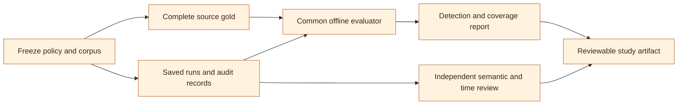

# What to implement and test first

Build the shared offline comparison contract first. Before adding another
extractor or running a collection pilot, every arm must consume the same frozen
sources, return inspectable observations and processing statuses, and be scored
against the same complete-source human gold. This makes a subsequent comparison
answer a research question instead of comparing incompatible counts.

The experiment scaffold in this branch compares saved files without calling
models. Its synthetic smoke example verifies the mechanics. It does not test
whether Quarry, LangExtract, DELM, GLM, DeepSeek, or Gemini performs better on real
research data. Live collection, external adapter execution, student studies, and
Georgia Tech compute measurements remain separate, explicitly authorized work.

## Implementation order and delivery gates

| Order | Build or prepare | Finish when |
| --- | --- | --- |
| 1 | Common offline evaluator and normalized run contract | Frozen sources, complete gold, two saved runs, failures, costs, and exact evidence yield a reproducible comparison report; invalid proposals remain inspectable |
| 2 | Inspectable semantic adjudication and review-time capture | Humans can assess meanings and inclusion decisions against complete source text; suggestions, decisions, reversals, and elapsed review time are distinct |
| 3 | LangExtract and DELM adapters | Each pinned implementation exports the common contract, original output, filtering/alignment decisions, status, and cost basis; adapter fixtures pass before live calls |
| 4 | Matched-component and native-workflow comparisons | Models, prompts, parsing, budgets, cache conditions, and differing policies are declared; all arms retain the fixed source denominator |
| 5 | Reliability fault experiments | Interrupted, failed, truncated, and uncertain outcomes can be recovered or explicitly left unfinished without losing the audit trail |
| 6 | Student usability study | Researchers can use their own agent harness to set up and complete a bounded study, inspect evidence, correct annotations, and reproduce exports |
| 7 | Approved Georgia Tech compute measurements | The actual allocation, model/runtime revision, throughput, resource use, and costs are measured and recorded rather than inferred from a local demo |

Existing Quarry evidence inspection and reversible annotation are useful for
step 2. A dedicated blinded semantic study workflow, richer rubrics, and review
timing instrumentation still need implementation. LangExtract and DELM adapters
are **planned**, not supplied by this scaffold. Existing cluster configuration
and offline cluster rehearsals are not measurements on a Georgia Tech cluster.



The human-gold path must not use the saved run's candidates as its starting list.
The final report needs both paths: occurrence detection and semantic quality.

## Research questions and hypotheses

State these as hypotheses, not present capabilities or measured results. Freeze
the primary contrast, outcome, inclusion policy, budget grid, and analysis before
examining held-out outcomes.

| Hypothesis | Primary comparison | Outcomes and important controls |
| --- | --- | --- |
| H1: grounded union and specialist passes improve the recall/cost frontier | A predeclared single-extractor baseline versus Broad union; Broad versus Specialists; Specialists versus the same number of additional broad calls | Complete-source occurrence recall, precision, false negatives, unique gold recoveries, semantic validity, and cost; same corpus and finite caps; fresh cold caches |
| H2: assisted semantic review reduces annotation time without unacceptable loss of adjudicated quality | Source-first manual annotation versus model suggestions plus complete-source review | Minutes per complete source, semantic quality against independent adjudication, additions/deletions/corrections, and reviewer disagreement; a predeclared noninferiority margin and source-family assignment |
| H3: explicit state and auditing make interrupted collection recoverable and assessable | Identical saved/fake responses under a normal run and controlled faults; later, compatible live adapters under the same fault protocol | Retained grounded observations, pending/failed statuses, recovery work, duplicate requests, uncertain billing exposure, and export reproducibility; do not equate recovery with provider-side exactly-once billing |
| H4: the researcher's own agent reduces setup burden while preserving understanding and control | Agent-assisted setup in the student's existing harness versus the documented direct workflow | Task completion, active setup time, correction cycles, researcher comprehension of scope/billing/evidence, unsafe attempted actions, and reproduction success; control task difficulty, prior experience, and order |

For H1, choose the primary single-model baseline using development data or an
advance rule. Do not choose the winning single extractor after looking at test
scores. Report all arms and negative results. Extra specialist calls can improve
recall by spending more; the equal-call broad-repeat control helps distinguish
the effect of a specialist lens from the effect of additional inference.
Union of fixed accepted sets cannot lower their set recall under the same
matcher. Demonstrating that monotonic property is not a novel empirical result.
The useful claim is additional human-valid discoveries at a justified precision,
review effort and cost. Include repeated calls to the best development-selected
single model under the same resource envelope as the mixed-model union.

For H2, a quality difference whose interval is not statistically significant does
not demonstrate noninferiority. Declare a scientifically justified margin,
measure uncertainty, and collect enough independent units for that analysis.
Grounding alone cannot validate a meaning, cultural association, novelty claim,
idea interpretation, stance attribution, or readability judgment.

## Phase 0: calibrate the research policy, not the test answers

Start with terms, the primary output, across the three starter domains. These are
proposed uses inspired by public NLPx research. They are not PI requests, student
assignments, reproductions of the cited datasets, or validated benchmarks.

| Domain and starter | Researcher decides before collection | Calibration cases to include |
| --- | --- | --- |
| Evolving vocabulary: `neologisms` | What evidence qualifies a new expression or a new sense; communities, dates, languages, and named-entity policy | New spellings, familiar spellings with a different use, ambiguous senses, established vocabulary, names, and sources with no eligible term |
| Multilingual cultural vocabulary: `cultural` | Whether entities are included; languages and communities; what counts as cultural association; who can adjudicate each language | Original scripts, code switching, transliterations, culturally situated senses, ordinary entities, translation ambiguity, and negative sources |
| Scientific/medical vocabulary: `jargon` | Whether established technical vocabulary is included; full-term boundaries, abbreviations, reader population, and source formats | Multiword jargon, abbreviations without an expansion, ordinary words in medical prose, PDF page evidence, parsing failures, and negative sources |

[NEO-BENCH](https://arxiv.org/html/2402.12261v4) motivates distinct expression and
sense policies. [Camellia](https://arxiv.org/abs/2510.05291) and
[CARE](https://arxiv.org/abs/2504.05154) motivate language/community-aware cultural
collection and separate human judgments.
[MedReadMe](https://arxiv.org/abs/2405.02144) motivates medical span and readability
questions. These publications guide the policy; their reported results do not
transfer to this pipeline. See [research rationale](RESEARCH.md) and the
[public-research-inspired recipes](../examples/lab_recipes/README.md).

Use roughly **9–12 complete sources per domain for calibration**, drawn from
several independent families and relevant languages/formats. This is a practical
starting range for finding policy and adapter mistakes, not a power calculation
or a quota. Keep related versions, translations, reposts, papers, and conversation
threads in one family. Do not use hundreds of spans from one document as hundreds
of independent samples. Add explicit negative sources; avoid constructing every
source around an already-known target term.

The student can ask their existing agent:

> Use Quarry to prepare an offline study of evolving community terms and new
> senses. Draft the neologism policy, examples, source scope, and a source-family
> map from my supplied materials. Show unresolved research choices and a cost
> estimate. Keep discovery and real inference disabled. Prepare blank complete
> source review packets before extraction. Do not construct gold from candidates.

For the other domains, change the research question and starter, and specify the
actual languages or technical field. The agent drafts the inputs; the researcher
reviews the inclusion boundaries, proposed sources, compute ownership, and
limits. Preserve the original brief, agent output, corrections, reviewed recipe,
model configuration, source list, and their hashes. Agent memory is not evidence
that a source exists, has a license, or represents a community.

## Phase 1: freeze sources and create complete gold

1. Establish a sampling frame and inclusion policy independently of extractor
   output. Declare convenience sampling when that is what was used. Record
   selection and exclusion reasons, access failures, language/domain, available
   dates, rights, and document families. The fixed source denominator is the
   declared study corpus, not every potentially relevant page online.
2. Ingest and inspect the parsed text. Preserve raw/text hashes, parser revision,
   and useful locations. If original layout matters, archive permitted originals
   separately; a raw hash by itself does not preserve the original bytes. A
   scanned PDF without usable text remains a visible parsing failure until an
   explicit OCR or text-supply procedure is applied.
3. Freeze family-grouped development and test splits before tuning. Use a new
   study when a prior run already exposed the intended test content. Quarry's
   local pre-extraction freeze gate cannot prove there was no exposure through a
   personal agent, another project, or a published benchmark.
4. Give qualified humans the **complete frozen test sources**, blank packets,
   and the fixed rubric. Label every eligible observation and occurrence,
   including `complete: true` packets with zero records. Include sources that
   later fail, are filtered out, remain pending, or exhaust an extraction budget.
   Their gold positives remain in the comparison denominator.
5. Use independent annotation and adjudication where feasible. Record annotator
   language/domain qualifications, training, disagreement, resolution, and
   annotation version. Do not let the system being evaluated serve as its own
   semantic gold judge. Do not ask candidate reviewers to claim exhaustive gold
   after reviewing only the extracted list.
6. Record exact Unicode code-point spans with half-open boundaries and matching
   source-text hashes. Byte offsets and browser UTF-16 indices are different
   units. Keep human sense labels separate from model-generated paraphrases.

Follow [complete-source evaluation](EVALUATION.md) for Quarry packet preparation
and validation. A `complete` label asserts a human procedure; it is not something
software can independently certify. Keep the blank original, submitted labels,
and adjudicated gold as separate artifacts.

This common-text benchmark conditions on the master corpus's parsing. It does
not measure observations lost before that text was frozen. For an end-to-end
parsing experiment, establish independently checked reference text/locations
from the originals, then score each parser/extractor against that reference.
An arm's parse failure can then retain gold positives. If a master source has no
reference text or human gold, report it as unscorable acquisition/parsing coverage;
do not manufacture an empty negative packet. The current comparison contract
requires frozen text and complete gold for every scoreable corpus source.

For a first live pilot, plan around **20–30 independent source families per
domain**, subject to annotation and inference resources. Revise that plan from
calibration variance, effect size, within-family dependence, language strata, and
the desired interval width or power. That range may be inadequate for a
noninferiority claim or separate conclusions in many languages. Report the actual
source/family counts, not only term counts. Keep calibration families outside the
pilot test set and preregister any expansion rule before looking at its outcomes.

## Phase 2: the common offline comparison

The scaffold accepts a corpus, complete gold, and saved normalized runs. It does
not launch extraction, search, model servers, or schedulers. See the
[working example and input contract](../examples/experiments/README.md).

```sh
python examples/experiments/offline_demo.py --out outputs/experiment-smoke
termfinder compare-experiments outputs/experiment-smoke/neologisms/study.json \
  --out outputs/experiment-smoke/neologisms/rechecked-report.json
```

Use a fresh output directory for the demo. It builds separate offline projects
for all three starters, with partial Broad, completed Broad, and Specialists
results on the same frozen synthetic sources in each cell. These are not a real
dataset or results from external libraries. Re-scoring saved files needs no
credentials.

Each adapter must preserve the submitted proposals, including malformed,
unaligned, filtered, and duplicate proposals, in its own raw archive. The
normalized run declares whether it supplies `raw_proposals` or only a
`grounded_inventory`, plus provenance, costs, and one processing result for
**every** corpus source. The common evaluator checks
exact source hashes and verbatim spans. Invalid proposals appear in
`raw_proposals.invalid_queue`; they are not silently converted into valid
observations. Report `submitted`, `exact_grounded`, `invalid`, duplicate grounded
observations, and exact-grounding rate alongside detection scores. Quarry's
snapshot bridge supplies its grounded inventory, not every raw model proposal;
its raw-proposal grounding rate is null with `raw_proposals_not_supplied`, not
100%. Retain the engine audit separately and distinguish proposal populations in
any cross-system comparison.

Detection scores use exact accepted observations under the declared matching
unit. Invalid proposals are reported separately, so this is not a score of every
raw generative claim. Failed, pending, excluded, uncertain, and partial sources
remain in the full gold universe. A partial source can earn true positives from
its valid retained observations; unrecovered gold positives are false negatives.
Report coverage and per-source results alongside precision/recall/F1 by domain
and language. Operational `complete` status does not prove complete extraction.

Optional paired percentile bootstrap resamples whole source families and uses
the same sampled families for both arms. Record the seed, requested samples,
effective replicates, and null-interval reasons; fewer than two families or
undefined replicate metrics can prevent an interval. Dependence, an inadequate
sampling frame, and biased human labels are not fixed by bootstrapping. Tiny
synthetic fixture intervals are engineering output, not scientific uncertainty.

Use the native `occurrence` unit for span detection. `source_term` answers a
different lexical presence question and is restricted to term studies. Exact
shared sense-label matching is optional and stricter; it does not recognize free
paraphrase equivalence. Publish boundary and sense adjudication separately.

## Phase 3: semantic adjudication before efficiency claims

Build the review packet/UI around an occurrence with its full source, locations,
and provenance. A human should be able to distinguish observed wording,
source-supported definition quotations, model-proposed meanings, original
contexts, generated translations, and human decisions. Add a rubric version,
reviewer identifier, unavailable-value reasons, and timed review events. Retain
the complete grounded inventory beside any approved subset and keep reversals
visible. A semantic decision must not erase the original proposal or evidence.

For neologisms, assess contextual sense and the declared novelty evidence; first
observation in this corpus is not an actual coinage date. For cultural records,
assess association, sense, and translation using appropriately qualified humans.
For jargon, assess technical inclusion and any proposed gloss; lay difficulty is
a separate judgment. Use an adjudicated ontology when label equality matters.

Run H2 using distinct or counterbalanced source families so a reviewer does not
first create gold and then appear faster when reviewing the same source's
candidates. Randomize arm assignment and record active review versus waiting
time, final quality, additions, removals, corrections, and disagreements. The
assisted arm must read complete sources to recover omissions. Candidate-only
review time answers a narrower question and cannot support a claim that the
finished dataset has the same completeness.

The [LangExtract launch blog](https://developers.googleblog.com/en/introducing-langextract-a-gemini-powered-information-extraction-library/)
links to [Goel et al.'s medical annotation study](https://proceedings.mlr.press/v225/goel23a.html).
That PaLM 2 and expert-refinement study motivates measuring review time and
quality separately. Its reported human-time savings are not a prediction of
Quarry's performance or a benchmark of current LangExtract.

## Phase 4: external adapters and fair comparisons

Pin exact library and adapter revisions before running either comparison track.
For an initial source audit, LangExtract v1.7.0 was inspected at
[`70cfb988cc25f15d8b04a1e57bd52a777207c0c6`](https://github.com/google/langextract/tree/70cfb988cc25f15d8b04a1e57bd52a777207c0c6).
DELM's paper-linked code is
[`bde5e0d9f031226cb4d143b75c9218ec08475c4b`](https://github.com/Center-for-Applied-AI/delm/tree/bde5e0d9f031226cb4d143b75c9218ec08475c4b);
its [v1 paper](https://arxiv.org/abs/2509.20617v1) describes an experiment-oriented
extraction toolkit with validation, caching, and cost tracking. Those features
must not be dismissed as absent merely because Quarry has its own implementation.
If testing newer revisions, name them as separate configurations.

**Matched-component track:** hold frozen parsed text, gold, model revision,
instruction intent, few-shot examples, output fields, matching rules, and token/
time/spending caps constant as far as the APIs permit. Record unavoidable
differences in schema envelopes, system prompts, chunking, and provider behavior.
Vary one factor at a time before the full-system comparison. Useful Quarry arms
are GLM only, DeepSeek only, Broad grounded union, Specialists, and an equal-call
broad-repeat control. Extra adapters for those ablations remain implementation
work; the shipped smoke exercises only Broad and Specialists.

**Native-workflow track:** use each tool's recommended/default configuration
within a declared finite resource envelope. Keep the same frozen corpus, full
gold, common matcher, cost ledger, and source denominator. Report the different
model/configuration choices so this measures whole workflows rather than a
single extraction algorithm. Do not advertise a native-workflow win as evidence
that one resolver is inherently better.

LangExtract's
[alignment defaults](https://github.com/google/langextract/blob/70cfb988cc25f15d8b04a1e57bd52a777207c0c6/langextract/extraction.py#L136-L162)
allow fuzzy and partial matching; its
[exact matcher lowercases tokens](https://github.com/google/langextract/blob/70cfb988cc25f15d8b04a1e57bd52a777207c0c6/langextract/resolver.py#L1246-L1272).
Preserve those statuses and generated strings. Apply the common literal-span
check for the matched track; do not claim non-null positions are automatically
verbatim. Its
[multi-pass merge](https://github.com/google/langextract/blob/70cfb988cc25f15d8b04a1e57bd52a777207c0c6/langextract/annotation.py#L46-L84)
gives earlier overlapping spans priority. Keep separate pass outputs when
studying an evidence-preserving union, and label that as an adapted arm rather
than the native merge. DELM preprocessing/filtering decisions must remain
inspectable; paragraphs or sources skipped by a keyword filter retain their
positive and negative gold in the full-corpus denominator.

Run cold arms in fresh projects with independent caches. A warm Specialists
extension that reuses Broad work is a useful separate operational experiment,
but must report incremental and total cost; it cannot be compared to a cold arm
as if all prior work were free. Use paired sources, a fixed run order or
randomized order, pinned provider settings, and declared repeats for stochastic
variation. Temperature zero does not guarantee identical future model replies.

Each run records discovery, parsing, extraction, specialist, and translation
costs, even when a stage was knowingly unused and costs zero. Unavailable costs
are null with a reason. Preserve simulated, configured token estimates, provider
invoices, and unmetered amounts as different bases. Report uncertain reservations
separately from known cost subtotals. Account separately for personal-agent
planning, external search/OCR, annotation labor, and compute allocation costs;
zero per-token service fees do not mean a local/cluster experiment is free.

LangExtract's
[current benchmark runner](https://github.com/google/langextract/blob/70cfb988cc25f15d8b04a1e57bd52a777207c0c6/benchmarks/benchmark.py#L222-L264)
reports positional entity counts and timing, while its
[fuzzy benchmark](https://github.com/google/langextract/blob/70cfb988cc25f15d8b04a1e57bd52a777207c0c6/benchmarks/fuzzy_benchmark.py#L143-L200)
uses planted alignment cases. These do not replace complete-source extraction
gold. Counts, agreement, successful parsing, and coverage flags are not recall.

## Phase 5: reliability faults

Start with fixtures and fake providers so faults require no paid inference.
For each fault, keep the source set and scripted proposals constant, save the
intermediate state, resume or stop under the same finite limits, and compare the
grounded inventory and exported records to the uninterrupted reference.

| Fault | What to inspect |
| --- | --- |
| Interrupt before dispatch, during a call, and after response/before persistence | Pending/running/uncertain states, recoverable work, reservations, and any duplicate request risk |
| Timeout, rate limit, transient failure, malformed response, or refusal | Bounded retries, error visibility, retained raw proposals, and unaffected source results |
| Truncated output or dense source | Continuation/smaller windows, remaining limits, retained discoveries, partial coverage, and exhaustion state |
| Budget/call/deadline stop and cancellation | Explicit unfinished sources and jobs; no completion claim or silent scope expansion |
| Invalid PDF or missing source | Parsing/retrieval failure with lineage; positives are still missed under the fixed source benchmark |
| Cache reuse and a changed recipe/prompt/model/source | Correct reuse versus invalidation; cold/warm costs; no stale result presented as new inference |
| Annotation reversal and saved-version export | Complete inventory preserved; history reversible; the same stored records export without model calls |

Separate engine tests from adapter capabilities and provider billing behavior.
An uncertain request may have been billed even if no response was saved. A
successful retry is not evidence of exactly-once billing. Retain failures in the
study artifact and report when recovery changes the planned resource envelope.

## Phase 6: student usability in their own harness

Begin with a small formative session, for example 4–6 consenting researchers,
to find confusing steps. That is a usability calibration exercise, not a powered
claim about all PhD students. Recruit a later sample appropriate to the intended
population and comparative design. Follow applicable institutional requirements
before treating participant measurements as publishable human-subject research.

Use each student's own approved ChatGPT/Claude/Codex or other harness. Keep
credentials under the student's or institution's configuration, not in the
research recipe or an agent-generated file. Rehearse tasks offline:

1. Describe a question and choose a starter, evidence unit, scope, and limits.
2. Have the agent draft inputs; correct one deliberate boundary case and one
   out-of-scope proposed source.
3. Identify whose model service would run and whose account/allocation would
   pay before enabling real inference. Inspect the cost estimate and exclusions.
4. Freeze complete-source review packets before extraction; then run the offline
   collection and inspect an occurrence against its source.
5. Find a semantic mistake, annotate it, undo the annotation, and locate the
   unchanged complete grounded inventory.
6. Resume interrupted work, identify a budget stop and processing failure, save
   a dataset version, and reproduce its export without another model call.
7. Explain what exact grounding proves, what recall requires, and what remains
   uncertain about model meanings, source sampling, dates, and billing.

Measure task completion and comprehension as well as elapsed time. Record
researcher interventions and agent correction loops; hiding JSON is helpful only
if the resulting plan is inspectable. Do not conflate improvements from a better
harness/model with improvements in Quarry. Preserve harness/model/version and
prompt provenance with consent, excluding credentials and unrelated chat history.

## Phase 7: Georgia Tech compute measurements

Use [compute ownership](COMPUTE.md), [the cluster procedure](GT_COMPUTE.md), and
[site-profile examples](../examples/gt-compute/README.md) to prepare a concrete
configuration. Do not guess an account, partition, GPU, module, host, storage
policy, access entitlement, or lab allocation. A student or administrator must
supply those site facts and authorize the specific finite resource request.

After a separately approved allocation is available, hold the checkpoint,
quantization, runtime revision, parser, recipe, frozen source mix, and inference
caps fixed. Measure server cold start, model load, wall time, input/output
throughput, concurrency, GPU memory/utilization, retry behavior, and completed
source/window counts. Record scheduler job/allocation identifiers and resource
limits with the run, without exposing credentials. Compare local/API/cluster
results only when model and configuration differences are stated.

Report GPU-hours or measured allocated time, storage/network costs when known,
service token charges if any, and unavailable infrastructure/energy costs with
reasons. A local zero-rate profile or an offline scheduler transcript is not a
cluster throughput or cost result. No paid API call, scheduler submission, model
download, or long-lived service is authorized by this roadmap or its examples.

## Artifacts a reviewer should receive

| Reviewer question | Required evidence |
| --- | --- |
| Did the agent change the scientific question or source scope? | Original brief, draft/corrections, reviewed policy and source plan, versions/hashes, and bounded execution record |
| Are these actual observations or generated interpretations? | Frozen source text/hash, exact spans and locations, raw outputs, invalid queue, generated-field labels, and human judgments |
| Can filtering and failures inflate recall? | Complete positive/negative gold, all-source statuses, fixed denominator, skipped-source reasons, coverage and false negatives |
| Is the result independent of tuning? | Frozen family split, calibration/test separation, prior-exposure statement, prompt/configuration histories, and preregistered primary contrasts |
| Is an efficiency gain real? | Equal-resource controls, cold/warm distinction, stage cost bases and missingness, reviewer-time protocol, quality margin, and uncertainty |
| Can the released records be recovered? | Stored dataset version, schemas, source/use constraints, parser/model/adapter versions, saved responses, and export hashes |
| Does it generalize to NLPx research? | Actual sampled population, qualified annotations, domain/language/family counts, confidence limits, negative outcomes, and explicit limitations |

See [the publication protocol](PUBLICATION_PROTOCOL.md) for the full evidence
chain. Publication readiness means claims have inspectable support and declared
limits; it is not a guarantee of acceptance. Full table-record extraction,
conversation-dataset construction, and automatic benchmark generation remain
extension points. Establish the term workflow and its evaluation before using
the same scaffold for other evidence units.
