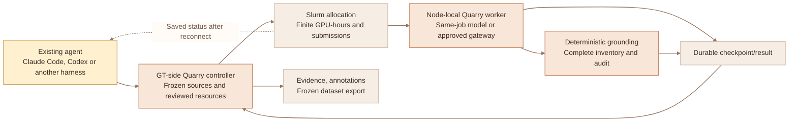

# Run GT extraction through your existing agent

**Keep Claude Code, Codex or your other existing harness as the interface. Run
Quarry's extraction jobs in your authorized Georgia Tech allocation.** Quarry
does not install a new planning agent or require a commercial extraction API.
A GT-hosted model may expose an OpenAI-compatible HTTP API; that protocol does
not mean inference is purchased from an external provider.

The cluster workflow submits a reviewed, finite Slurm job independently of the
chat connection. Closing the agent connection does not cancel a submitted job.
Quarry keeps sources, model replies, deterministic evidence checks, audit queues
and frozen exports attributable to the same reviewed study.



## What this release provides

| Implemented | Site-provided or future work |
| --- | --- |
| Validated site profile, separate from research recipes and model profiles | GT account, allocation, approved partition/QOS and storage |
| Hash-bound review of sources, model settings and requested resources | Administrator-reviewed model server and checkpoint staging |
| Bounded Slurm submission, saved status, cancellation and explicit resume | Automatic model downloads and container deployment |
| Optional fixed vLLM launch using reviewed, pre-staged files in the allocation | Arbitrary launch scripts, moving model revisions and remote model code |
| Node-local active SQLite state, consistent durable checkpoints and result import | Multi-node shared database, automatic distributed sharding |
| Allocation reservations and scheduler observations alongside extraction costs | A guarantee of the institution's invoice or allocation balance |
| Offline fake-scheduler checks | A verified live Phoenix deployment or local-model quality claim |

Choose one deployment:

1. **Serve a reviewed local model inside the same GPU allocation.** The optional
   `server` profile selects the fixed vLLM launcher. The operator supplies a
   preinstalled pinned runtime and complete hashed inventory of pre-staged safe
   model/tokenizer files. Quarry verifies them, starts loopback serving with
   bounded startup time, collects, checkpoints and stops its server. No weights
   are downloaded and no model-supplied Python/remote code runs.
2. **Use an existing approved institutional gateway.** Set `server=null` and
   request a CPU collector allocation (`gpus=0`, `max_gpu_hours=0`). The endpoint
   must be reachable throughout the job. Its separate serving allocation/cost is
   unknown to Quarry unless documented by the operator. An endpoint on a previous
   node's `127.0.0.1` will not follow a new allocation.

The site/runtime/server choices appear in the concrete resource review.
Configuration alone does not launch either mode. Agent-generated source or
extraction content cannot authorize a server launch or change its fixed command.

## The student experience

After the one-time installation and site setup, describe the study normally:

```text
Use Quarry with our reviewed GT compute profile. Keep my existing agent as the
planning interface. Collect emerging vocabulary from these permitted community
exports with Specialists mode. Preserve singleton uses and separate senses.
Prepare sources before GPU submission. Show the exact source list, extraction
models, failures, resource request, remaining GPU-hour cap and job-submission
cap. Submit only after I approve that concrete review.
```

Later sessions use the saved study:

| Your request | Agent operation |
| --- | --- |
| "Show my GT collection's progress." | Open the study; inspect the saved cluster job and optionally refresh Slurm status. |
| "My laptop was closed. Continue inspecting that job." | Reconnect and inspect the same job; do not submit a replacement. |
| "Stop this job." | Cancel the selected scheduler job; keep completed evidence, checkpoints and reservations. |
| "Resume the unfinished work within the remaining cap." | Review saved state and submit an explicitly approved bounded resume. |
| "Bring the completed result into my study." | Import the validated checkpoint/result; inspect failures and remaining work. |
| "Show evidence and undo my annotation." | Use the existing evidence/annotation tools against imported records. |
| "Save `gt-pilot-v1` and export it." | Freeze and export the local dataset version; no new model calls. |

An agent connection is a control interface. Quarry's ordinary local `collect`
still uses a connection-owned worker and requests cancellation on disconnect;
use the cluster tools for jobs that must outlive the conversation.

## One-time setup for the lab

### 1. Obtain the actual site settings

Your faculty sponsor and PACE administrator supply the permitted research
account, partition/QOS, resources, runtime, durable storage, node-local scratch
and endpoint-access rules. Do not infer allocation rights from course access or
student status. Phoenix is PACE's research cluster and uses Slurm; institutional
details can change. This repository does not prescribe a current GPU type,
hostname, module, partition or billing account.
[PACE participation](https://pace.gatech.edu/participation/),
[Phoenix](https://pace.gatech.edu/phoenix-cluster/),
[PACE Slurm guide](https://docs.pace.gatech.edu/phoenix_cluster/slurm_guide_phnx/).

### 2. Install the same reviewed Quarry build on the control and worker hosts

Use Python 3.11–3.13, the pinned dependencies, and a reviewed wheel or source
checkout. Follow [installation](../README.md#installation-on-macos-or-linux) and
[isolated/offline installation](VERIFICATION.md). An approved wheelhouse avoids
installing dependencies during a GPU allocation. Keep the earlier environment
available when upgrading. The cluster worker needs the same package version and
an accessible approved interpreter/runtime; Quarry does not install either.

Do CPU-bound acquisition and parsing before GPU submission. If a source needs
OCR or access not implemented by the collector, record it as failed/pending;
do not acquire extra sources or enable a paid OCR service from extraction output.
Archive original permitted bytes separately for parser replay.

### 3. Connect the existing harness to the cluster-side control process

The Slurm adapter runs where the reviewed Slurm commands are available. A local
Quarry server on a laptop does not magically submit to Phoenix. A harness that
supports SSH stdio MCP can run `termfinder-mcp` on an approved control host; use
the host's documented registration and your institution's reviewed SSH setup.
Otherwise, let your agent operate the installed CLI through its approved
terminal connection. Quarry does not create tunnels, acquire credentials or
rewrite your global harness settings.

Keep SSH host-key verification enabled. Never put private keys, tokens or
passwords in MCP arguments, URLs or repository files. Do not read or print secret
files to diagnose a connection. Check permitted credential presence/names only.
Only light control operations belong on a login node; inference runs in the
authorized allocation.

For an SSH stdio deployment the actual remote process is:

```text
termfinder-mcp --workspace /approved/local/control/studies \
  --cluster-storage-root /approved/durable/quarry-jobs --allow-cluster --allow-paid
```

`--allow-cluster` enables scheduler execution in this process. The legacy
`--allow-paid` flag enables real model requests, including self-hosted models
with zero per-token fees. They are separate gates. A tool call cannot enable a
disabled launch gate. Use the site-provided paths rather than these placeholders.
`--cluster-storage-root` authorizes that specific existing durable directory at
server launch. It must contain the selected profile's `durable_root`. Repeat it
only for other explicitly approved directories; do not grant a broad home/root
path. Without this launch setting, tools cannot choose unrelated shared storage.
Keep the default offline connection when creating an explicitly authorized real
connection; follow [connection migration](AGENT_NATIVE.md).

### 4. Configure the model and site profile

Ask your agent to configure the study's extraction model with `configure_compute`
and confirm it using `inspect_compute`. For a GT gateway, use the institutional
backend, verified HTTPS base URL, served model/version and credential environment
**name**. A loopback endpoint is appropriate only when the collector and server
really run in the same approved allocation/network namespace. Loopback does not
authenticate other processes on a shared host; require site isolation or an
authenticated gateway. [Compute configuration](COMPUTE.md).

Then have the agent prepare the separate cluster profile using the schema and
example in [examples/gt-compute](../examples/gt-compute/README.md). The researcher
selects the profile; `configure_cluster` records that actual decision and its
reference. Plans cannot replace it. Site profiles contain resources and reviewed
runtime/model metadata, never credentials or arbitrary shell scripts.

Configuration is inert. It neither submits work nor authorizes model downloads,
additional sources or unlimited retries. A reviewed optional vLLM launch occurs
only inside an explicitly approved allocation. Different compute or
model settings after extraction has begun require a separate study so provenance
and costs remain attributable.

### 5. Select a serving pattern

For the simplest existing-gateway setup, complete the CPU site template with
`server=null`, zero requested collector GPUs and zero collector GPU-hours.
Supply the verified authenticated institutional endpoint separately through
`configure_compute`. Keep the gateway's own serving allocation and costs in the
study's external accounting notes.

For same-job GPU extraction, complete the vLLM site template. The lab stages a
reviewed model and installs its exact pinned vLLM runtime through the approved
wheelhouse/container procedure. Quarry itself does not install vLLM or obtain
weights. Configure the extractor's served model and matching loopback URL, then
bind the optional server profile to that exact alias. The worker checks its
complete safe file inventory and hashes, starts the fixed loopback command with
bounded startup, and stops it after collection/cancellation/failure.
The startup limit includes file verification, package-version checking and model
readiness, and must fit before the shutdown grace. Choose it from a small
authorized pilot; large checkpoints can spend meaningful allocation time
loading. Keep staged artifacts immutable after verification. A readiness
response verifies availability of the served model name, not extraction quality.
In this mode the declared model-artifact SHA-256 is the canonical hash of the
complete file-hash inventory, not the hash of one weight shard.
The site runtime must work under the worker/server's deliberately minimal
environment. Shell module activation and inherited `LD_LIBRARY_PATH` are not
supported; use an approved self-contained runtime compatible with the node's
drivers instead of relying on your interactive terminal's environment.

The first server adapter serves one reviewed model per allocation. It supports
Broad and additive Specialists with that model; those passes are not independent
models. Independent multi-model serving must use a separately reviewed compatible
gateway/profile, or a future server adapter that preserves all model provenance.
Do not silently replace the preserved GLM/DeepSeek API preset with a different
checkpoint and call its output equivalent.

Neither a template nor a vLLM-ready configuration authorizes submission. Show
the fixed launcher, complete artifact inventory/digests, model/context settings,
resource request, startup/shutdown limits and cumulative caps in the concrete
review. See [the profile examples](../examples/gt-compute/README.md).

## Review, submit, inspect and import

1. Prepare the brief and recipe through the normal agent workflow. Use
   `model_profile="configured"` for the selected extractor. Submit the valid
   bounded plan, capture its approved sources and prepare the complete review.
   Inspect source failures, sampling limits and frozen held-out packets.
2. Relay the researcher's actual approval of that collection review using
   `approve_review`. Request `prepare_cluster` for its saved review ID. Inspect
   the concrete sources/model bindings, runtime, resource request, worst-case
   allocation reservation, remaining GPU-hour and cumulative submission limits.
   Ask the agent to read the complete resource profile, artifact inventory and
   fixed launcher. If a response is only a preview, `cluster_review_text`
   recovers the exact saved review in bounded chunks inside the same harness.
   The agent handles those chunks; no browser or manual JSON handoff is required.
   Changed bindings require a new concrete review.
3. After the researcher's approval of that exact cluster review, call
   `submit_cluster`. Save the scheduler job ID. A timeout during submission is
   an uncertain outcome; do not blindly resubmit or assume Slurm rejected it.
4. Use `inspect_cluster` to read durable status. Reconnect and reopen the same
   study after a laptop/chat interruption. Queue waiting is separate from
   extraction progress. Stopped/failed jobs and unprocessed sources remain
   visible. Cancellation requests a stop; in-flight work can still settle.
5. Import the validated result through `import_cluster`. Then use the normal
   evidence, annotation, version and export tools. A result import is a local
   study update, not publication or an external upload.

Complete intended bounded resumes before importing and annotating the control
inventory. Imports require unchanged origin bindings and do not overwrite later
local edits. Keep a stopped partial result inspectable; do not call it complete.

The terminal equivalents and notebook example are in
[the working examples](../examples/gt-compute/README.md). The agent manages saved
IDs and structured settings; students do not need to author JSON or shell code.

## Storage and interruption behavior

**Keep each live SQLite database on one node's local filesystem.** SQLite WAL
requires all processes accessing a database to share one host and does not work
over a network filesystem. Shared storage holds consistent checkpoint files and
artifacts, not a live database concurrently opened across nodes.
[SQLite WAL](https://www.sqlite.org/wal.html).

The control host's study database also stays on its approved private local
filesystem. The site profile's `durable_root` is a separate, pre-existing approved
directory visible to both the control host and worker. Quarry stores the frozen
bundle, consistent checkpoint files, control receipts and results there; it does
not open a live WAL database on that shared directory. Keep a consistent backup
of the control study for recovery if its host's local storage is lost.

The cluster worker stages one reviewed project into node-local work storage,
runs one collector, and writes consistent backups to the approved durable
location. SQLite's online backup includes committed WAL state; copying only a
live `project.sqlite3` is not a safe backup.
[SQLite online backup](https://www.sqlite.org/backup.html).

Checkpoint retention is bounded: keep the latest and preceding generation for
the current worker, plus every checkpoint/resume file referenced by saved jobs.
After publishing a consistent new receipt, prune only that worker's unreferenced
generations under the control lock. Prior allocations and frozen source/review
artifacts remain untouched. Successful published generations are bounded by
`4 × max_submissions` (usually `2 × max_submissions` in sequential runs).
A hard crash can leave an unpublished orphan for operator inspection; this is
not a guarantee of total disk use after filesystem failure. A checkpoint/control
storage failure stops dispatch instead of retrying a full backup every poll.

Advance scheduler signals and the finite worker deadline request graceful
cancellation/checkpointing before walltime expires. A forced kill or lost node
can lose work after the latest durable checkpoint. Resume uses that checkpoint,
retains recorded uncertain outcomes and reservations, and may need to repeat
uncheckpointed work. It cannot promise exactly-once inference or billing.
[Slurm signals and time limits](https://slurm.schedmd.com/sbatch.html).

One active cluster job owns a study. Do not point job arrays at its database or
copy the study to evade resource caps. Multi-node sharding is a later extension:
it needs independent state per shard and validated deterministic result merging.

## GPU efficiency and publication evidence

Start with a representative small pilot and measure sources/hour, tokens/second,
GPU-hours, startup/queue time, truncations, OOMs, retries and partial coverage.
Prepare sources before allocation and keep an approved server warm across many
windows. Tune the model profile's bounded concurrency against actual memory and
server capacity. The default one-request-per-model setting is conservative,
not a claim of optimal GPU utilization.
The fixed vLLM launcher enables prefix caching and discards its stdout/stderr.
Use site-approved firewall/container/network isolation: loopback for the HTTP
API alone does not isolate PyTorch distributed networking such as TCPStore.
Offline Hugging Face settings prevent model downloads, not all runtime network
access. Hashes and a minimal environment do not create an OS sandbox.
[vLLM security guidance](https://docs.vllm.ai/en/latest/usage/security/).

The resource cap bounds the submitted Quarry allocation. In same-job vLLM mode
that allocation includes the serving GPUs. An external model gateway uses a
separate serving allocation whose startup, GPU-hours and fees are not metered by
this worker; select the CPU collector profile rather than requesting idle GPUs.
Worker elapsed GPU-hours remain a lower bound relative to the full reserved
allocation, excluding scheduler/prolog time. Site administrators account for
gateway serving separately.

Model-server batching and vLLM prefix caching can improve utilization; they are
server settings. Prefix caching reuses shared prompt computation and does not
speed generation of new output tokens. Quarry's durable response cache is a
different mechanism: it replays saved extraction results under the source,
recipe, prompt and model signature.
[vLLM prefix caching](https://docs.vllm.ai/en/stable/features/automatic_prefix_caching/).

Token-aware admission splits windows without changing original Unicode offsets.
Trusted Python integrations can register a reviewed full-prompt tokenizer;
without one, the fixed cluster worker uses an explicitly recorded conservative
UTF-8-byte estimate and chat-template reserve. This is an estimate, not exact
counting for every tokenizer. The release does not add GPU autotuning or model
deployment. Do not improve apparent throughput by silently dropping
specialist passes, hard sources, truncation recovery or single-model discoveries.

Record checkpoint/file digests, tokenizer and chat-template versions,
quantization, runtime/container digest, GPU hardware, decoding and server
configuration. A declared model revision is an operator statement, not proof of
the bytes a remote gateway loaded. LLM reruns may vary on different runtimes or
hardware; fixed seeds and temperature zero do not establish bitwise inference.
Frozen exports reproduce stored records without rerunning inference.
[vLLM reproducibility](https://docs.vllm.ai/en/latest/usage/reproducibility/).

Compare any new local/quantized model against independently annotated complete
held-out sources. Report precision, recall and false negatives by domain and
language with source/family-grouped splits. Two passes through the same checkpoint
are not two independently trained models; keep their provenance truthful. A
grounded span proves occurrence, not its suggested sense or measured recall.
[Evaluation](EVALUATION.md), [publication protocol](PUBLICATION_PROTOCOL.md).

## Keep source privacy explicit

GT extraction can keep source documents and raw replies within approved GT
storage. Your planning agent still uses its configured external provider.
Tool output sent to that agent may transmit source text to it. Prefer summaries,
counts and hashes for progress; inspect sensitive contexts only through an
approved local view or a separately authorized external-agent request. An
institutional backend setting is not an automatic privacy guarantee.

## First authorized GT pilot

The software build and synthetic tests do not submit any GT jobs. A live pilot
needs sponsor/administrator-approved access, compatible reviewed runtime and
model endpoint, permitted source handling, durable storage and finite resource
limits. Start with a small held-out, multilingual/domain-representative corpus.
Exercise a real queue, walltime checkpoint, disconnect/reconnect, explicit resume,
result import and byte-identical re-export. Measure quality and utilization before
increasing scale. Keep unresolved failures and missing runtime/source rights
metadata visible in the publication record.
