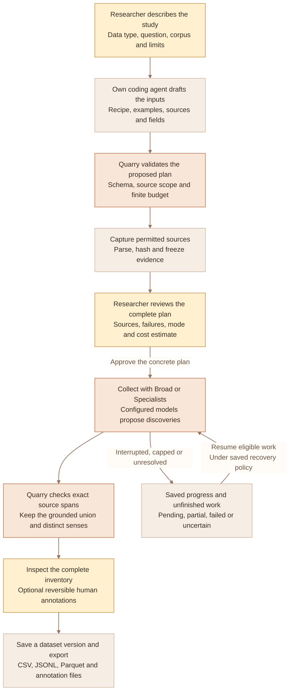
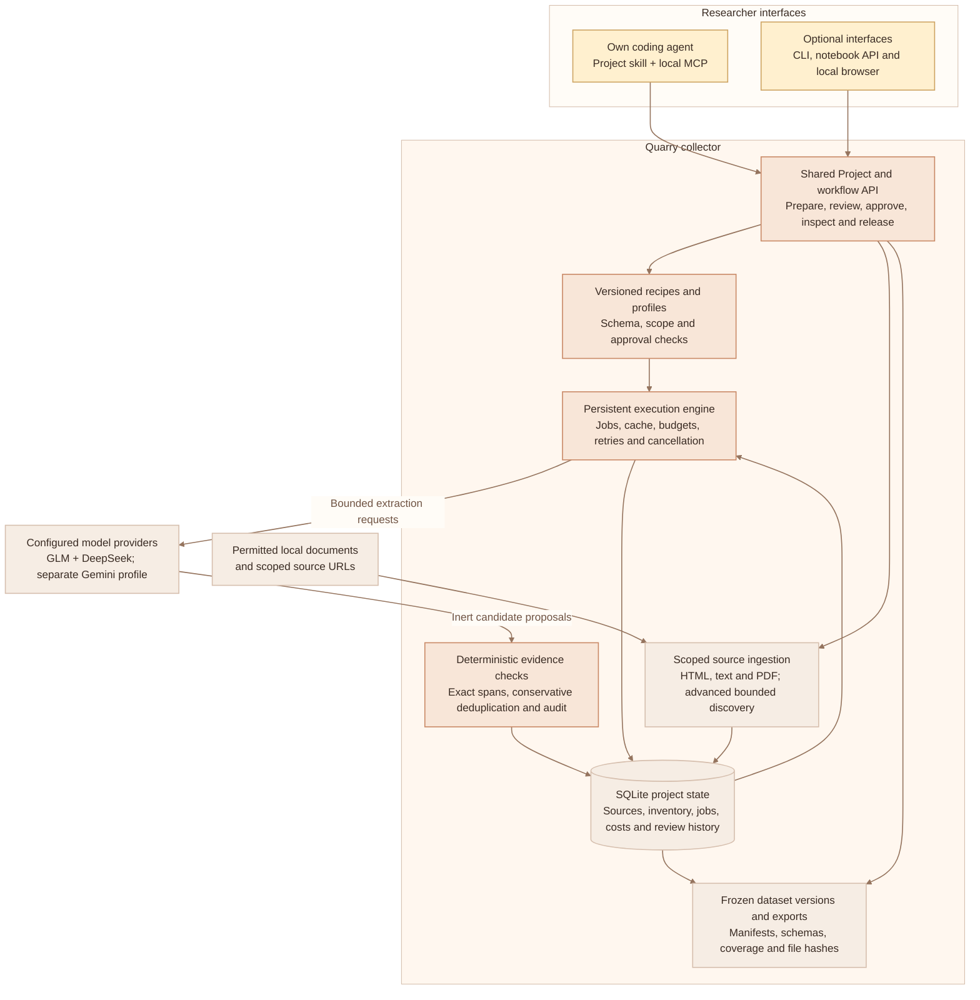
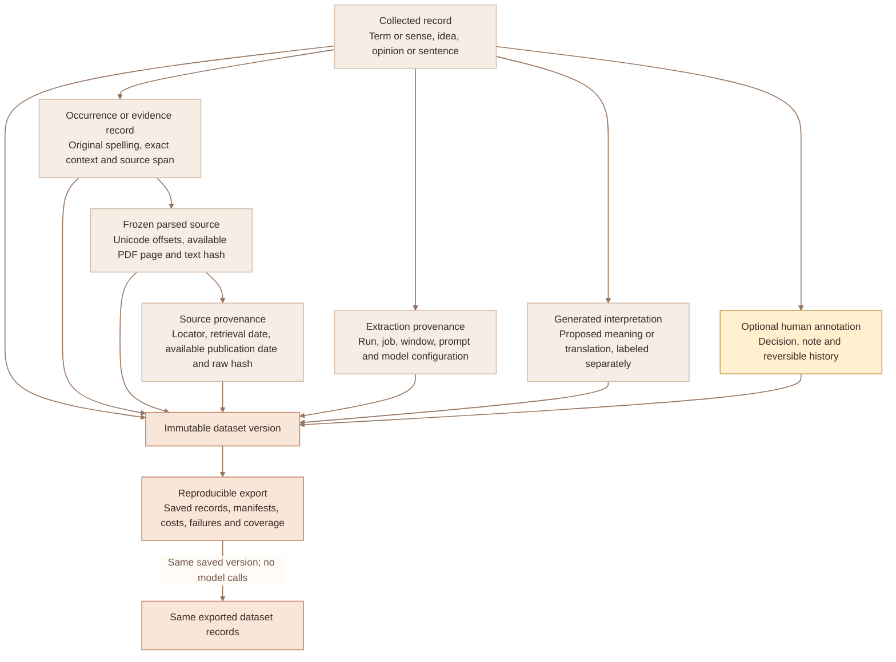
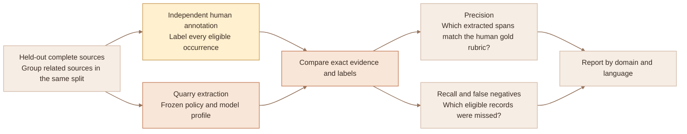

# Quarry — workflow and components

Quarry is the product name for the V6.4 collector at
[`BobbY-24/quarry`](https://github.com/BobbY-24/quarry). These diagrams describe
the implemented architecture. The existing `termfinder` commands, Python API and
`v6-collect-research` skill identifier remain compatible.

## 1. Researcher workflow

The connection starts with a synthetic fake-provider gate. Real collection needs
an explicitly authorized provider connection and the reviewed finite plan.
Preparing inputs or viewing a plan does not dispatch extraction. Human relays
are recorded declarations, not authenticated signatures.
Exhausted budgets, disabled models and uncertain outcomes can require an explicit
resolution or a newly reviewed plan. Unknown reservations persist; retries of
uncertain requests may incur duplicate charges.

## 2. Components and responsibilities

Agent planning and model generation remain nondeterministic. The collector
owns deterministic admission, evidence checks and stored-record export.
An extraction response cannot invoke tools or enlarge source scope. The model
profile, recipe and prompt versions are configuration inputs, not hardcoded
choices spread through the engine.
The guided agent workflow uses its reviewed finite source list and keeps
discovery disabled. Explicit bounded discovery is an advanced engine capability.

## 3. Evidence and reproducibility

Offsets refer to frozen parsed text, not byte positions in the original PDF or
HTML. Original bytes need a separate lawful archive for parser replay.
Unavailable metadata uses null with a reason. Grounding proves occurrence,
not correctness of a proposed meaning, truth, novelty or recall.

## 4. Source-level evaluation

Reviewing extracted candidates alone cannot measure missed records. Candidate
counts and model agreement are not recall measurements.
Default metrics compare exact spans and language. Interpretation or sense matching
is optional and does not establish factual correctness.
