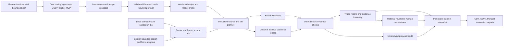

# Quarry architecture and guarantees

Quarry uses the independent V6 collector engine. The [four diagrams](diagrams.md)
show its workflow, components, evidence lineage and independent evaluation.

Quarry is an independent Python package. It does not import V3, V4, V5, sibling
virtual environments, existing output folders, or personal absolute paths.
`Project` owns a SQLite database in a researcher-chosen directory. The database
is the durable authority; exported files are derived from immutable snapshots.

The conversational control layer in `workflow.py`
combines plan validation/application, approved-source capture, pre-extraction
freeze, measured-length estimation, reviewed collection/resume, and named
snapshot/audit/export. Preparation never creates extraction jobs. Approval binds
the brief, bundle, recipe, profile/rates, prompt versions, captured source
content/metadata, cost assumptions, and frozen packet hashes. Final checks and
engine admission share the project lock. Jobs, costs, caches, and later human
annotations do not invalidate an otherwise unchanged review. Packet hashing is
streamed; browser polling reads saved state and admission rechecks its bindings.

The researcher's own harness is the primary interface. A one-time,
project-local connection installs the packaged skill and registers the stdio
tools in the selected analysis workspace. `harness.py` preflights the owned
paths and connection, preserves unrelated settings, refuses unsafe collisions,
and never launches the host or changes its trust policy. Generic clients receive
an explicit connection bundle rather than guessed client configuration.

The MCP server can remain fixed to one project, or be bound at launch to a study
workspace. Workspace tools create and reopen named immediate-child studies;
each retains its own SQLite inventory, recipe, source scope, approval and costs.
Study selection cannot escape the workspace or change while collection runs.
Paged review tools expose the concrete policy, source list, failures, rates,
estimate and planning provenance inside the harness; bounded text slices allow
inspection of a long field that would otherwise be previewed. The optional
browser's three tabs call the same study operations.

Workspace checks reject traversal, static symlinks and observed directory/file
replacement, including checks before project initialization and SQLite access.
They enforce logical tool scope, not operating-system isolation. Python SQLite
still uses path-based file opens; use a private trusted workspace and the
documented OS sandbox/container when hostile local code could race filesystem
operations. A malicious process under the same user can also edit that user's
research files directly. Connection setup never changes filesystem trust or
grants a host new operating-system permissions.

Agent planning remains outside the deterministic layer; no generated
tool code runs in the collector. MCP collection returns asynchronously, permits
bounded status/cancellation and paged inspection, and cannot change its
launch-time paid gate. On disconnection it requests cancellation; already sent
requests can finish or have uncertain outcomes. Model annotations are stored as
audit suggestions, separate from human review. Relayed human approval is a
recorded declaration rather than authenticated identity. The
[simple procedure](../guides/student-workflow.md) explains the current guided protocol limit
for changed plans after processing; the lower-level engine remains available.

## Cluster collection through the existing agent

`cluster.py` adds a separate controller for reviewed Slurm jobs. Research recipe,
model profile and site resource profile remain distinct. The controller freezes
a source-backed input bundle using consistent SQLite backup, binds it to the
approved collection review and site configuration, and presents a separate
hash-bound resource review. Submission requires an actual researcher decision,
finite cumulative submission/GPU-hour caps, and an immutable scheduler execution
gate. Real extraction retains the separate real-request gate. Source text,
extraction replies and planning bundles cannot change the scheduler profile or
execute shell commands.

The submitted command invokes the installed `cluster_worker` with its reviewed
interpreter. The worker stages the active database onto node-local scratch,
checks the runtime executable digest, runs the same extraction/evidence engine,
and writes consistent durable checkpoints and results. Operators either select
an existing approved gateway with a CPU collector allocation or a fixed optional
vLLM launcher inside the GPU allocation. The latter verifies a complete hashed
inventory of pre-staged safe checkpoint/tokenizer files and the pinned runtime;
it has bounded startup and server cleanup. Quarry does not download weights,
execute model-supplied Python/pickle/remote code, or accept arbitrary launchers.
Gateway artifact digests remain operator declarations; a gateway model name is
not proof of its loaded bytes.

Cluster status and submission history live outside the worker's active database.
Reconnecting the existing agent reads that history; disconnecting does not
cancel Slurm work. Unknown submission outcomes remain reserved and need explicit
scheduler reconciliation before replacement. Resume keeps the same reviewed
scope and cumulative caps. Import validates a completed checkpoint against its
reviewed bundle and brings the resulting inventory into the control study.

SQLite WAL is never used as a live multi-node shared database. One active cluster
job owns a study; durable checkpoints use SQLite online backup, not a raw copy
of a writing database. Sudden node loss can lose work after the last durable
checkpoint. Graceful walltime signals reduce that risk but cannot establish
exactly-once inference. Slurm-reported allocation use is distinct from token
fees and remains uncertain when scheduler accounting is unavailable.

The lab supplies actual Slurm access, site-approved storage and endpoint rules.
A laptop-side MCP process has no built-in remote scheduler access. An existing
harness may use a reviewed SSH stdio connection to the cluster-side controller,
or operate its CLI. This transport is external to the collector. See
[the complete GT procedure](../guides/gt-compute.md) and
[site profile/CLI/notebook examples](../../examples/gt-compute/README.md).

## Separation of records

`data_type` selects terms, ideas, opinions, or sentences. Every type has exact
contiguous observed wording in frozen source text. Generic `records` and
`evidence` views carry this contract; `terms` contains only lexical records and
`occurrences` is a compatibility evidence table. Existing term IDs remain stable.
Nonlexical IDs include source and span so opinions with the same wording in
different sources retain separate identities. Proposed interpretations are
generated text; they never replace observed spans.

Terms represent an expression, language, community, and conservative literal
sense. Occurrences represent exact evidence spans in frozen parsed source text.
Multiple models/windows can support one occurrence while retaining independent
provenance. Distinct senses are not collapsed by semantic similarity. Runs, jobs,
sources, costs, discoveries, audit proposals, annotation events, and relation
events remain separate records.

Offsets are Unicode code points in the exported extracted text. They are not
UTF-8 byte positions or coordinates in the original HTML/PDF file. PDF evidence
also carries a 1-based page location when available. Parsing retains headings,
paragraphs, table text, and recognizable conversation turns, but does not promise
perfect layout or table reconstruction. Source raw and parsed-text hashes identify
the evidence versions.

The PDF parser's worker uses a minimal environment, isolated Python startup and
finite CPU/memory/file/time/page/text bounds. Those bounds do not restrict its
filesystem/network access. The verified OS sandbox/container workflow provides
that separate isolation for untrusted document parsing.

The schema distinguishes original context from translation, observed quotations
from model-proposed meanings, suggestions from human annotations, retrieval time
from publication date, and first observation in this inventory from coinage.
Unavailable values are null with a reason. A source-grounded occurrence proves
that text appeared; it does not establish the proposed meaning, novelty, cultural
association, scientific truth, or quality.

## Durable work and cache

Jobs are queued per frozen source passage and extractor. SQLite transitions make
completed work durable; resume recovers interrupted work and dispatches unfinished
jobs. The worker count, requests, retry attempts, deadline, and cost reservations
are finite. Cancellation stops additional dispatch and preserves completed work.
Provider-side cancellation and exactly-once billing cannot be promised. An
uncertain transport outcome remains visible and consumes a conservative unknown
reservation rather than being silently retried as free work.

The engine saves each configured model alias's circuit and cooldown in SQLite. Indexed
ready queues and a scoped incremental cost ledger admit bounded work; one retry
probe per unavailable alias leaves healthy lanes running. Five consecutive
failures disable the default lane across resumes, while its unfinished coverage,
unknown charges, and grounded discoveries remain. Built-in HTTP requests have
subprocess deadlines and independent worker alarms. Browser inspection uses
bounded pages and lazy source loading; exports stage on disk and publish their
manifest last. SQLite online backup preserves committed WAL data. See
[the long-run procedure](../reliability/long-runs.md) for timing, tuning, failure handling,
and the remaining single-machine and frozen-dataset memory limits.

The cache contract includes source content, extraction-policy recipe fields,
prompt, model configuration, and version identifiers. Mode, budget, and export
changes do not invalidate completed broad replies. Repeated work within that
contract reuses valid replies.
Changed sources or policies produce new work without deleting the earlier
inventory. A provider alias that points to a moving remote model cannot guarantee
bitwise repeat generation; the returned model version and configured model are
recorded. Immutable snapshots reproduce stored records without any provider call.

Truncated responses can salvage complete grounded proposals and enqueue bounded
smaller passages or a continuation allowance. Parent discoveries survive child
recovery. Exhausted recovery remains partial. Failed parsing, malformed replies,
unresolved offsets, missing attributes, and other rejected proposals remain
auditable. There is no model judgment stage that removes grounded candidates.

## Costs and reproducibility

The estimator considers parsed lengths, windows, expert routes, profile rates,
recovery allowance, cache assumptions, discovery rates, and parsing/OCR/translation
assumptions. Link-count estimates are ranges with explicit document-length and
token assumptions. Multilingual/PDF workloads require their own assumptions.
Known billed token costs and uncertain reservations appear separately, grouped
by stage. Zero local parsing cost means no service charge; it does not mean zero
CPU time. OCR is an extension, not a silently invoked external service.

Snapshots freeze recipe, profile, prompts, source lineage, processing status,
terms, evidence, annotation history, costs, failures, coverage, and source-use
constraints. Export manifests describe record schemas and per-file hashes. Use
the snapshot identifier for a reproducible dataset version; collecting new data
does not alter saved versions.

## Interfaces and extension boundaries

Agent setup is a data handoff, not an autonomous external-agent runtime. The
researcher controls type, question, languages, communities, dates, domains, corpus
folders, mode/profile, source cap, and budget in a plain-language form. Quarry saves a
versioned prompt and complete JSON template. The external agent may propose
examples, attributes, a finite source list, selection history, sampling and
evaluation settings. Deterministic validation rejects scope/budget expansion,
stale brief hashes, credentials, malformed inputs, unrelated local files, forged
retrieval dates, unresolved research choices, and enabled discovery. It does not
establish that a proposed URL, search history, permission, or rubric is correct.

Applying an explicitly reviewed bundle saves compiled input files and imports
eligible local documents. URLs are staged for a separate fetch. The saved source
map binds each plan source to its ingested version; a new reviewed plan is needed
for content refresh. Models cannot invoke setup methods or execute tools.
Planning events and canonical bundle objects have a hash chain included in
snapshots and exports. This is an integrity aid, not an authenticated signature.

Before any extraction job is planned for the selected source content,
`freeze_agent_corpus` creates a corpus snapshot, source-family splits, and blank
complete-source annotation packets. This reduces candidate-review leakage; it
cannot verify what annotators saw outside Quarry. Frozen publication audits join
sources, plans, records, exact evidence, jobs and provenance without fetching or
calling models. Missing original-byte archives, unresolved source rights and
unfinished coverage remain visible review findings. Original bytes must be
archived separately by the researcher for parser replay.

The CLI, Python API, and local loopback browser use the same `Project` methods.
The browser exposes setup, mode, estimate, ingest, progress, evidence, annotations,
undo, snapshot, and export. Session authentication protects state-changing UI
requests. Credentials are configured through named environment variables and are
never accepted as CLI arguments or browser form fields.

Implemented connector capabilities are documented in the README and source
guide. Future extensions should preserve the same scopes, job budgets, evidence,
and audit contracts: authenticated repositories, OCR, full table-record
extraction, full conversation-dataset construction, reviewed translation stages,
and automatic benchmark generation. No extension is enabled merely because a
source or extractor suggests it.
